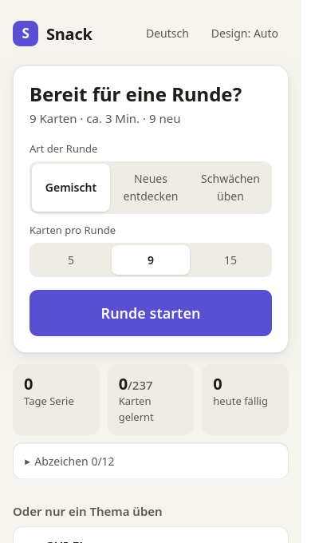
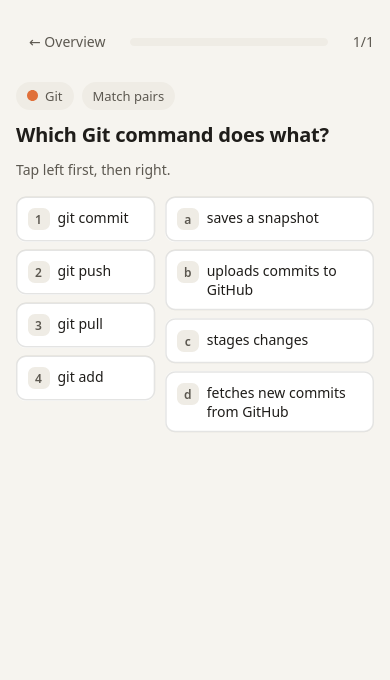
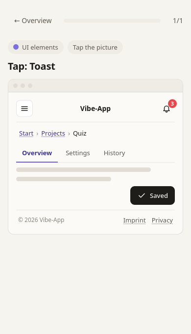
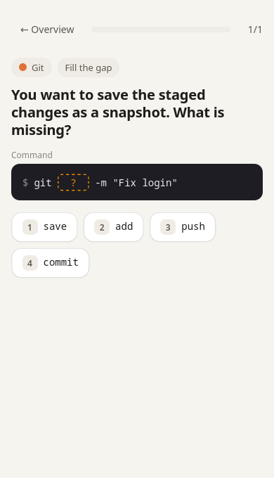

# Snack

**Vibe-Coding-Karten in kleinen Happen.** Ein Skill für [Claude Code](https://claude.com/claude-code), der aus dem, was du baust, ein kleines Quiz macht, das du wirklich zu Ende spielst.

Gebaut für Menschen mit ADHS und für alle, die in kleinen Häppchen besser lernen als aus langen Anleitungen.

[English version](README.md)

<p>
  
  
  
  
</p>

## Was Snack macht

- **Ein Quiz im Browser.** Runden mit 5, 9 oder 15 Karten, etwa drei Minuten. Kein Konto, kein Server, nichts verlässt deinen Rechner.
- **Es wächst aus deiner eigenen Arbeit.** Tipp `/snack` in einem Projekt, und Claude schlägt Karten zu genau diesem Projekt vor: warum es eine Datei gibt, was ein Befehl in deiner README macht, was der Fehler von eben bedeutet.
- **Es lernt deine Fachwörter.** Mit einer freiwilligen Regel in deiner `CLAUDE.md` erklärt Claude einen Begriff beim ersten Mal und trägt ihn ins Quiz ein.
- **Acht Kartenarten**, damit keine Runde wie die andere ist: eine Antwort wählen, wahr oder falsch, Lücke füllen, mehrere richtig, Reihenfolge, Fehlerzeile finden, ins Bild tippen, Paare zuordnen.
- **Drei Arten von Runden:** gemischt (zwei Drittel neu), Neues entdecken, Schwächen üben.
- **Deutsch und Englisch.** Rund 200 Starter-Karten in beiden Sprachen.

## Installieren

Du brauchst Claude Code und einen Browser. Node.js ist freiwillig (damit laufen das Einrichten und die Kartenprüfung).

```bash
git clone https://github.com/DonDavis-vibe/snack-vibe-cards.git
mkdir -p ~/.claude/skills
cp -r snack-vibe-cards/snack ~/.claude/skills/snack
```

Unter Windows (PowerShell):

```powershell
git clone https://github.com/DonDavis-vibe/snack-vibe-cards.git
Copy-Item -Recurse snack-vibe-cards\snack $HOME\.claude\skills\snack
```

## Benutzen

Öffne Claude Code in einem deiner Projekte und tipp:

```
/snack
```

| Wann | Was passiert |
|---|---|
| Beim ersten Mal | Claude fragt, wo dein Quiz liegen soll (Vorschlag `~/snack-quiz/`), richtet es ein, bietet die Regel „Lernen nebenbei“ für deine `CLAUDE.md` an und durchsucht das aktuelle Projekt nach Karten-Ideen. |
| Später, in jedem Projekt | Claude durchsucht das Projekt, zeigt bis zu 8 Karten-Ideen und trägt die ein, die du auswählst. Angesehen wird nur, was seit dem letzten Mal neu ist. |
| `/snack quiz` | Drei kurze Fragen direkt im Chat zu dem, woran du gerade arbeitest. |

Du hast ein Quiz für alle deine Projekte. Du öffnest es jederzeit über die `index.html` in deinem Quiz-Ordner. Ein Lesezeichen hilft.

## Deine Daten

- Das Quiz ist ein Ordner mit einfachen Dateien. Der Lernstand liegt in deinem Browser.
- Der Projekt-Scan liest keine `.env`-Dateien, Schlüssel, Datenbanken oder Dateien aus deiner `.gitignore`. Geheimnisse und persönliche Daten kommen nie auf Karten.
- Snack lädt nichts irgendwohin hoch.

## Das Quiz ohne Claude ausprobieren

Öffne `snack/assets/quiz/index.html` im Browser. Das ist das Quiz nur mit den Starter-Karten.

## Aktualisieren

```bash
cd snack-vibe-cards && git pull
cp -r snack ~/.claude/skills/
```

Das nächste `/snack` bemerkt die neue Version und aktualisiert deinen Quiz-Ordner. Deine eigenen Karten, deine Begriffe und dein Lernstand bleiben unberührt.

## Karten schreiben oder verbessern

Die Starter-Karten liegen in `snack/assets/quiz/karten/`, eine Datei pro Thema. Das Format steht in `snack/references/karten-schreiben.md`. Nach einer Änderung:

```bash
node snack/assets/quiz/scripts/check-karten.js snack/assets/quiz --zweisprachig
node snack/assets/quiz/scripts/sim.js snack/assets/quiz
```

Der erste Befehl prüft das Format in beiden Sprachen. Der zweite spielt mit dem echten Auswahl-Code viele Runden durch und zeigt, wie abwechslungsreich sie sind.

## Grenzen

- Terminal-Karten gehen von einer Bash-ähnlichen Shell aus (Linux, macOS, WSL oder Git Bash unter Windows).
- Die Mini-Runde im Chat ändert den Lernstand im Browser-Quiz nicht.
- Wer den Quiz-Ordner verschiebt oder umbenennt, fängt beim Lernstand von vorn an, weil der Browser ihn an den Ordner bindet.

## Lizenz

- Code: [MIT](LICENSE)
- Quiz-Karten in `snack/assets/quiz/karten/`: [CC BY-SA 4.0](LICENSE-CARDS.md)
