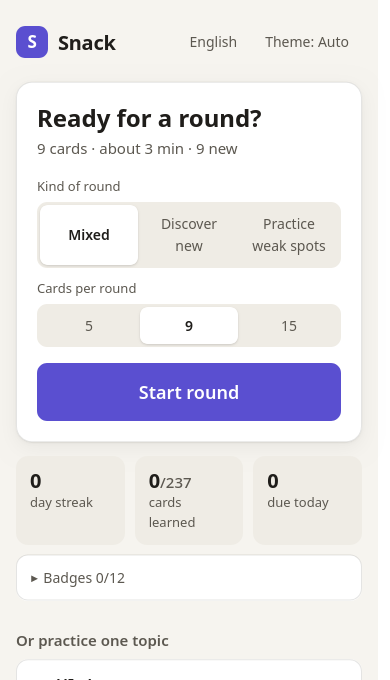
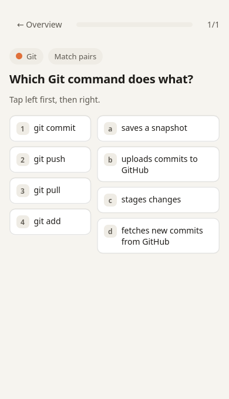
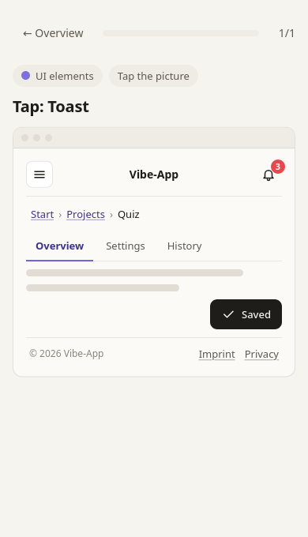
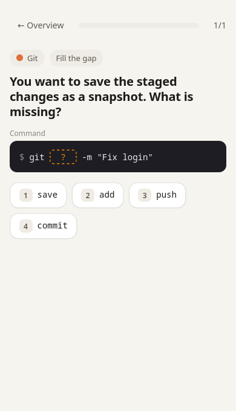

# Snack

**Bite-sized vibe coding cards.** A skill for [Claude Code](https://claude.com/claude-code) that turns what you build into a small quiz you actually finish.

Built for people with ADHD and for everyone who learns better in small bites than from long tutorials.

[Deutsche Fassung](README.de.md)

<p>
  
  
  
  
</p>

## What it does

- **A quiz in your browser.** Rounds of 5, 9 or 15 cards, about three minutes. No account, no server, nothing leaves your computer.
- **It grows from your own work.** Type `/snack` in a project and Claude suggests cards about that project: why a file exists, what a command in your README does, what the error you just hit means.
- **It learns your vocabulary.** With one optional rule in your `CLAUDE.md`, Claude explains a term the first time it uses it and adds it to the quiz.
- **Eight kinds of cards**, so no two rounds feel the same: pick one, true or false, fill the gap, select all, put in order, spot the faulty line, tap the picture, match pairs.
- **Three kinds of rounds:** mixed (two thirds new), discover new, practice weak spots.
- **German and English.** About 200 starter cards in both languages.

## Install

You need Claude Code and a browser. Node.js is optional (it runs the installer and the card checker).

```bash
git clone https://github.com/DonDavis-vibe/snack-vibe-cards.git
mkdir -p ~/.claude/skills
cp -r snack-vibe-cards/snack ~/.claude/skills/snack
```

On Windows (PowerShell):

```powershell
git clone https://github.com/DonDavis-vibe/snack-vibe-cards.git
Copy-Item -Recurse snack-vibe-cards\snack $HOME\.claude\skills\snack
```

## Use

Open Claude Code in one of your projects and type:

```
/snack
```

| When | What happens |
|---|---|
| The first time | Claude asks where your quiz should live (default `~/snack-quiz/`), sets it up, offers the "learn as you go" rule for your `CLAUDE.md`, and scans the current project for card ideas. |
| Later, in any project | Claude scans that project, shows up to 8 card ideas and adds the ones you pick. Only what changed since the last scan is looked at. |
| `/snack quiz` | Three quick questions right in the chat, about what you are working on. |

You have one quiz for all your projects. Open it any time by opening `index.html` in your quiz folder. A bookmark helps.

## Your data

- The quiz is a folder of plain files. Progress is stored in your browser.
- The project scan never reads `.env` files, keys, databases or anything in your `.gitignore`, and it never writes secrets or personal data onto cards.
- Nothing is uploaded anywhere by Snack.

## Try the quiz without Claude

Open `snack/assets/quiz/index.html` in a browser. That is the quiz with the starter cards only.

## Update

```bash
cd snack-vibe-cards && git pull
cp -r snack ~/.claude/skills/
```

The next `/snack` notices the new version and updates your quiz folder. Your own cards, your terms and your progress stay untouched.

## Write or improve cards

Starter cards live in `snack/assets/quiz/karten/`, one file per topic. The format is documented in `snack/references/karten-schreiben.md`. After a change, run:

```bash
node snack/assets/quiz/scripts/check-karten.js snack/assets/quiz --zweisprachig
node snack/assets/quiz/scripts/sim.js snack/assets/quiz
```

The first command checks the format in both languages. The second plays many rounds with the real selection code and prints how varied they are.

Field names in the card files are German (`frage`, `optionen`, `erklaerung`), because that is where the project started.

## Limits

- Terminal cards assume a Bash-like shell (Linux, macOS, WSL or Git Bash on Windows).
- The mini round in chat does not change the progress in the browser quiz.
- Moving or renaming your quiz folder resets progress, because the browser ties it to the folder.

## License

- Code: [MIT](LICENSE)
- Quiz cards in `snack/assets/quiz/karten/`: [CC BY-SA 4.0](LICENSE-CARDS.md)
